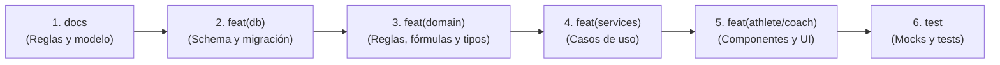

# Convenciones de Git y Commits en NEYEN Performance OS

Este documento define la política oficial de commits y control de versiones para todo el equipo y agentes de desarrollo en **NEYEN Athletic Performance OS**. El objetivo es mantener un historial limpio, auditable, biseccionable (`git bisect`) y con trazabilidad directa hacia las **Reglas de Negocio (`BR-xx`)** y las **Reglas de Arquitectura (`AR-xx`)**.

---

## 1. Principio Fundamental: Commits Atómicos por Capa

> **Regla de oro:** Cada commit debe representar **una sola responsabilidad o cambio conceptual autónomo**.

**Nunca mezcles en un único commit:**
- Cambios de especificación/docs y código de implementación.
- Migraciones de base de datos y componentes de interfaz de usuario.
- Lógica de dominio pura y adaptadores de infraestructura o vistas.

Separar los commits por capa permite:
1. Revertir cambios de UI sin romper la persistencia de datos ni fórmulas fisiológicas.
2. Auditar migraciones de base de datos y esquemas D1/SQLite de forma aislada.
3. Comprender el orden de construcción de una feature de principio a fin.

---

## 2. Formato del Mensaje de Commit

Seguimos una variante de **Conventional Commits** adaptada a nuestro sistema de reglas:

```text
<tipo>(<ámbito>): <descripción concisa en español y minúsculas> [(BR-xx | AR-xx)]
```

### Regla del Propósito: Qué y Para Qué

Cada commit debe formularse respondiendo al criterio:
> **"Se edita [X] para establecer funcionalidad para el objetivo [X]"**

- **Qué se edita:** el archivo, tabla, módulo o regla específica.
- **Para qué objetivo:** la capacidad funcional o valor que habilita en el sistema.

*Evitá mensajes vagos como "cambios en ficha", "fix", "update". Especificá siempre la acción y su objetivo.*

### Tipos permitidos

| Tipo | Cuándo se usa |
|---|---|
| `docs` | Actualización de documentación, especificaciones funcionales, modelo de datos o reglas (`GEMINI.md`, `README.md`, specs). |
| `feat` | Nueva funcionalidad, cambio de modelo o ampliación de capacidades del sistema. |
| `fix` | Corrección de un defecto o comportamiento anómalo. |
| `refactor` | Reestructuración de código sin alterar su comportamiento externo ni añadir tests (ej. descomposición modular de componentes). |
| `test` | Incorporación o ajuste de tests unitarios, de integración, fixtures o datos mock. |
| `chore` | Tareas de tooling, dependencias, scripts de setup local o configuración de CI/CD / Wrangler. |

### Ámbitos (Scopes) del proyecto

| Ámbito | Módulos y directorios asociados |
|---|---|
| `(domain)` | Entidades, fórmulas fisiológicas (1RM, Epley, Brzycki, Foster sRPE, ciclo menstrual) en `src/core/` o `src/utils/`. |
| `(db)` | Esquemas SQL D1/SQLite (`schema.sql`), migraciones, adaptadores de persistencia en `src/infrastructure/db/`. |
| `(services)` | Casos de uso y orquestación de aplicación en `src/application/`. |
| `(athlete)` | Experiencia del alumno: Dashboard, RutinaActiva (`src/components/athlete/workout/`), CicloMenstrual, FotosProgreso en `src/components/athlete/`. |
| `(coach)` | Panel del coach: Ficha técnica del atleta, Macrociclos en `src/components/coach/`. |
| `(planner)` | Planificador de periodización: Editor de sesión, mesociclos y microciclos en `src/components/coach/planner/`. |
| `(catalog)` | Banco de ejercicios, categorías y equipamientos en `src/components/coach/exercise-bank/`. |
| `(wearables)` | Métricas de descanso, fases de sueño REM/profundo, HRV y simulación de smartwatch. |
| `(auth)` | Autenticación, Google OAuth, control de acceso RBAC (Coach vs Alumno) y onboarding de perfil en `src/components/auth/`. |
| `(ui)` | Componentes primitivos reutilizables (Button, Modal, Field, BottomNav, NeyenLogo) en `src/components/ui/`. |

---

## 3. Trazabilidad con Reglas (`BR-xx` y `AR-xx`)

Toda funcionalidad que implemente o modifique una regla de negocio o de arquitectura debe citar su código al final del mensaje:

- `feat(domain): fórmula de brzycki con autorregulación hormonal del -7.5% (BR-02)`
- `refactor(athlete): descomponer active workout modal en subcomponentes srp (AR-01)`
- `feat(db): tabla usuarios y perfiles personalizados para google oauth (AR-04)`
- `docs: incorporar directrices de arquitectura limpia y convenciones git (AR-00)`

---

## 4. Secuencia Canónica para Features Transversales

Cuando se implementa una nueva funcionalidad que impacta en múltiples capas del sistema (ej: registro de feedback sRPE y guardado en D1), los commits deben realizarse en este orden secuencial:



1. **`docs:`** Actualización de especificaciones, `GEMINI.md`, modelo de datos y roadmap.
2. **`feat(db):`** Nuevas tablas en SQLite / Cloudflare D1 (`schema.sql` y migraciones).
3. **`feat(domain):`** Tipos TypeScript en `src/types/`, fórmulas fisiológicas en `src/core/math/` o `src/utils/`.
4. **`feat(services):`** Casos de uso o adaptadores de infraestructura (`src/application/`, `src/infrastructure/`).
5. **`feat(athlete | coach | auth):`** Componentes interactivos, vistas y estilos modulares.
6. **`test:`** Fixtures, seeds de desarrollo local (`src/data/seedData.ts`) y tests unitarios.

---

## 5. Checklist antes de commitear

- [ ] ¿El commit hace una sola cosa bien definida (atómico)?
- [ ] ¿La compilación y tipos de TypeScript están limpios (`npm run build` o `npx tsc -b`)?
- [ ] ¿El análisis estático no arroja errores (`npm run lint`)?
- [ ] ¿El mensaje sigue la estructura `<tipo>(<ámbito>): <descripción> [(BR-xx | AR-xx)]`?
- [ ] ¿Responde al criterio "Se edita [X] para establecer funcionalidad para el objetivo [X]"?
- [ ] ¿Evitaste commitear archivos temporales, logs o claves secretas?

---

## 6. Cierre de Fases del Roadmap

Al completar cada fase o hito estipulado en el roadmap:
1. **Sin commits monolíticos**: Está prohibido agrupar todos los cambios de una fase en un solo commit ("fase completa" o "squash" ciego).
2. **Secuencia canónica obligatoria**: Se deben aplicar los commits atómicos por capa siguiendo el orden: `docs:` → `feat(db):` → `feat(domain):` → `feat(services):` → `feat(ui):` → `test:`.
3. **Cierre formal**: Tras completar los commits y verificar que los tests y el build estén limpios, cada fase concluye con PR hacia `main`, build en verde, deploy y tag semántico (`vX.Y.Z`).
